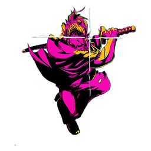

# Ziro Hub - Blox Fruits Official

<p align="center">
  
</p>

O hub mais completo, otimizado e indetectável para **Blox Fruits** no Roblox.

---

## 🚀 Como Executar no Jogo

Copie e cole o comando abaixo no seu executor (Delta, Codex, Wave, Fluxus, Synapse Z, Hydrogen, etc.):

```lua
loadstring(game:HttpGet("https://raw.githubusercontent.com/TrepoxS/bambambam/main/loader.lua"))()
```

---

## 🔑 Sistema de Chave

1. Ao executar o script pela primeira vez, uma janela moderna roxa (**Ziro Hub Gateway**) será exibida.
2. Insira a sua chave fornecida pelo operador no campo de texto e clique em **Enter / Validate**.
3. A chave será validada instantaneamente e salva automaticamente em `ziro_key.txt` no seu dispositivo — você **não** precisará digitar a chave novamente nas próximas execuções.

---

## ⚡ Funcionalidades em Destaque

- **Auto Farm Completo**: Farm de level inteligente, maestria de armas e estilos de luta com Fast Attack nativo.
- **Auto Race V2, V3 & V4**: Suporte nativo completo para todas as raças, incluindo a raça **Draco** com coleta em rajada instantânea de Fire Flowers.
- **Dragon Hunter & Dojo Quests**: Auto craft de Volcanic Magnet, coleta de Blaze Ember e auto combat contra bosses.
- **Sea Events Avançados**: Leviathan, Terrorshark, Kitsune Island e Frozen Dimension com noclip de segurança e anti-afogamento.
- **Interface Dark Purple Neon**: Esquema de cores roxo escuro / neon magenta (`rgb(245, 0, 237)`) com botão flutuante com animação de zoom e retorno elástico.
